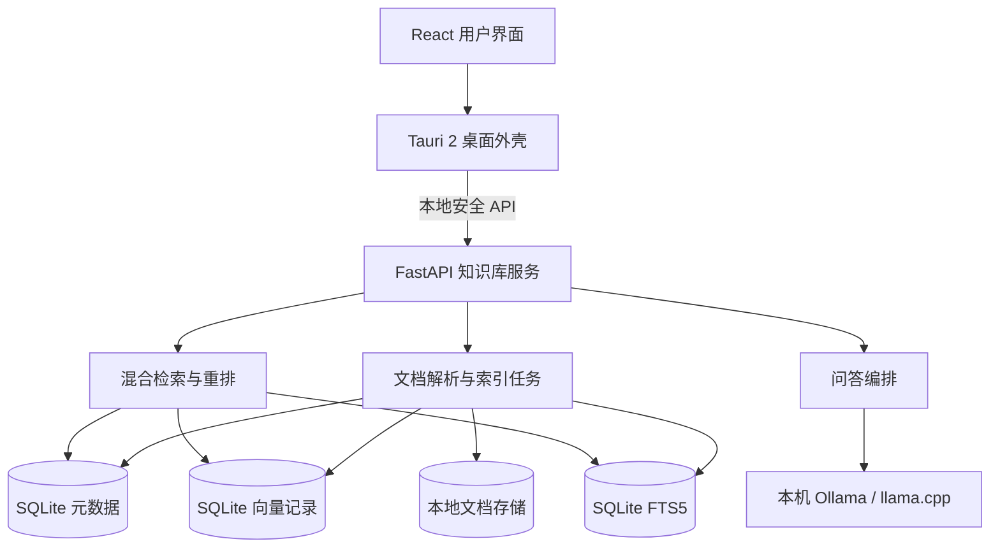

# Local Knowledge Hub

面向个人与企业的本地优先知识库系统。用户可以导入 PDF、Word、Excel、PowerPoint、Markdown、纯文本、网页及图片等资料，系统在本地完成解析、清洗、结构化切分、向量化、混合检索与重排，并通过本地或可选的云端大模型生成带来源引用的回答。

> 项目状态：主对话界面、Tauri 2 桌面壳和受保护的 FastAPI 本地服务已经接入。桌面版现已支持真实本地文档导入、扫描 PDF 本地 OCR、DOCX/XLS/XLSX/PPTX/HTML 结构解析、结构聚合式父子块切分、PDF 坐标高亮预览、SQLite 持久化、Ollama/轻量回退 Embedding、FTS5 + 向量 RRF 混合召回、独立本地特征重排、后台任务、检索质量门禁，以及基于真实召回结果的流式回答和来源引用。回答模型支持本机 Ollama、OpenAI 兼容服务和严格原文回退。

当前索引管线版本为 v2。旧索引会在“设置 → 检索”中显示重建提示，可前往文档管理按知识库手动重建；应用不会在未确认的情况下自动覆盖现有索引。对话查询先按“独立问题 / 明确追问 / 不确定”分流：完整问题即使很短也独立检索，明确追问改写成单一可检索问题，不确定时才结合本地 Embedding 主题相似度并采用双路召回。改写失败始终回退到当前问题，不会拼接上一题。多项问题会绕过仅能回答一个事实的快速规则并由回答模型逐项综合，带离职、交接或资产归还条件的工资问题不会被普通发薪日规则覆盖。Ollama 回答使用原生流式传输，通过 `keep_alive` 和进程内向量缓存减少重复冷启动与重复 Embedding。

> **硬性指标：Windows 与 macOS 必须基于同一套产品源码、同一套 UI 和同一套业务核心交付。** 不接受先完成 Windows 版本、再另写 macOS 版本的实施方式。不同平台可以拥有独立安装包和少量受控的系统适配代码，但不得形成两套产品代码。

## 产品目标

Local Knowledge Hub 的目标不是简单包装一个聊天页面，而是建立一套可验证、可追溯、可私有部署的知识问答基础设施：

- 数据默认保存在用户设备或企业内网。
- 回答必须能够追溯到文档、章节、页码和原文片段。
- 支持完全离线、混合推理与企业集中部署三种模式。
- 同一套产品架构支持 Windows 和 macOS。
- 模型、向量库、OCR 与文档解析组件均可替换，避免供应商锁定。

## 核心能力

- 多格式文档导入与批量处理
- 扫描文档 OCR 与版面识别
- 基于文档结构的智能切分
- 本地 Embedding 与向量索引
- 关键词、向量及元数据混合检索
- Reranker 二次重排
- 多知识库和多轮问答
- 流式 Markdown 回答与代码高亮
- 文档名、章节、页码和原文引用
- 增量更新、内容去重和索引版本管理
- 本地模型与云端兼容模型自由切换
- 企业用户、角色、知识库权限与审计扩展

## 当前可运行界面

当前前端使用 React、TypeScript、Vite 和 Lucide Icons，实现了：

- 左侧知识库与历史对话导航，可完全收拢并记忆状态，支持新建、重命名、置顶和删除对话
- 知识库切换、黑/白/灰主题切换与本地持久化
- Mock 流式回答、停止生成、重新生成、复制、反馈与推荐追问
- 可点击引用标记、来源加载状态及可开关的回答依据面板
- 桌面端左右分隔线拖拽调宽、键盘微调、双击复位与栏宽持久化
- 本地运行状态浮层、模型异常提示和应用级后台任务面板
- 1440、1280、1024、768 和 390 像素宽度下的响应式布局
- 真实文档管理页面，可导入 PDF（含扫描件 OCR）、DOCX、XLS/XLSX、PPTX、HTML、TXT 和 Markdown
- 文档处理状态、失败原因、重新索引和本地删除
- 可直接检查召回原文、页码、章节和相关度的检索测试面板
- 基于真实知识库检索的流式主对话、停止生成、无依据拒答和通用来源引用；PDF 来源可按命中坐标生成本地高亮预览
- “本地运行状态”与“设置 → 检索与索引”显示实际 Embedding、向量维度、混合检索模式和索引规模
- 桌面版会话与消息已迁入 SQLite；首次升级自动幂等导入旧 WebView localStorage 历史，不覆盖已有对话
- “设置 → 存储”提供数据库完整性状态、版本化本地备份、外部备份导入和恢复；恢复前校验并自动创建安全回退备份

### 本地启动

环境要求：Node.js 18 或更高版本。

```bash
npm install
npm run dev
```

Vite 会输出本地访问地址。生成生产构建：

```bash
npm run build
```

构建产物位于 `dist/`。Tauri 桌面版的知识库、文档、处理任务、检索、流式回答和引用已经连接真实 Knowledge API；浏览器预览保留独立 Mock Service，便于在没有桌面 Sidecar 时检查界面。

当前本地数据库 schema 为 v5。旧库首次启动会先在应用数据目录的 `backups/` 中创建 `pre-upgrade` SQLite 快照，再执行会话表迁移；迁移失败会恢复原数据库并停止启动。`.zhiyu-backup` 同时包含数据库、原始文档和哈希清单，导入或恢复前会检查格式、版本、路径、文件哈希及 SQLite 完整性。

### 当前本地索引实现

当前索引模式为 `hybrid-rrf-rerank-v1`：SQLite FTS5 负责关键词召回，Embedding 向量负责语义召回，两路结果使用 Reciprocal Rank Fusion 合并，再由 `local-feature-reranker-v1` 根据内容覆盖、章节、标题、精确代码、数字单位和少量受控同义表达重排。它是可重复的本地特征基线，不冒充 Cross-Encoder；未来模型重排器通过同一适配边界接入。

每个块保存 `embedding_model_id`、维度与索引版本；不同模型或不同维度的向量不会混合计算。结果分别保留召回分、重排分和证据分：召回分用于诊断候选来源，重排分只决定顺序，证据分用于拒答门槛，避免排序变化破坏安全校准。

长文本采用父子块：约 900 字符的子块负责向量化、全文召回和重排，最大约 3600 字符的父块只在命中后提供完整上下文。相同父块的多个子命中会在重排后去重；引用仍保留精确子块、稳定父块 ID、内容类型和位置元数据，避免用扩大后的上下文污染检索分数。

生产 Sidecar 默认以 `auto` 模式检测本机 Ollama 的 `bge-m3`：可用时使用 1024 维真实模型向量，不可用时回退到 256 维 `hashing-vector-v1`。遇到明确的 Ollama CUDA/PTX 加载不兼容错误时，适配器只对本次 Embedding 自动重试 CPU，并在界面显示“CPU 兼容模式”。回退或兼容状态不会伪装成正常 GPU 运行。Embedding 地址只接受 `localhost`、`127.0.0.1` 或 `::1` 的 HTTP 端口。

默认评测集为 `zhiyu-retrieval-v2`，包含 8 份多章节中文文档、19 个可回答问题和 3 个难负样本，共 22 个问题。它同时标注文档与章节，能够识别“找对文档但找错片段”。当前消融结果：

| Embedding | Reranker | Recall@5 | MRR | nDCG@5 | 片段 MRR | 可回答性准确率 |
|---|---|---:|---:|---:|---:|---:|
| hashing-vector-v1 | 关闭 | 1.0 | 0.9737 | 0.9806 | 0.9737 | 1.0 |
| hashing-vector-v1 | local-feature-v1 | 1.0 | 1.0 | 1.0 | 1.0 | 1.0 |
| Ollama BGE-M3 | local-feature-v1 | 1.0 | 1.0 | 1.0 | 1.0 | 1.0 |

CI 使用 `npm run api:eval:gate` 强制 Recall@5、MRR、片段 MRR 不低于 0.95，可回答性准确率保持 1.0。该数据集的 `provenance.type` 明确标记为 `synthetic`，只是工程回归基线，不等同于真实企业语料的最终质量。接入经授权和人工复核的脱敏企业语料时，使用 `--require-real-corpus` 强制验证 `sanitized-enterprise` 声明；具体格式见 [`services/knowledge-api/evaluation/README.md`](services/knowledge-api/evaluation/README.md)。

问答提供器现已支持三种运行方式：

- `Ollama`：默认地址 `http://127.0.0.1:11434`，默认模型 `qwen3:8b`。
- `llama.cpp / OpenAI 兼容`：连接本机 `/v1/models` 与 `/v1/chat/completions` 接口。
- `extractive-local-v1`：模型未运行、模型缺失、返回内容没有合法引用或请求失败时的严格原文回退。

在桌面版的“设置 → 模型与运行”中保存并检测模型。模型地址仅允许 `localhost`、`127.0.0.1` 或 `::1` 的 HTTP 端口，避免检索片段被意外发送到公网。无可靠检索依据时不会调用模型；模型回答必须使用 `[[1]]`、`[[2]]` 等有效来源标记，否则整条回答回退为真实原文。遇到明确的 Ollama CUDA/PTX 兼容错误时，对话模型会自动以 `num_gpu: 0` 重试，并将 CPU 兼容模式显示在运行状态中。

### 桌面端开发

首次安装本地服务依赖：

```bash
npm run api:install
```

启动 Tauri 桌面版时会先为当前平台构建 FastAPI Sidecar，再启动桌面应用：

```bash
npm run desktop:dev
```

可分别执行基础验证：

```bash
npm run api:test
npm run api:eval
npm run api:eval:gate
npm run api:eval:bge
npm run api:eval:experience:fast
npm run api:eval:experience
npm run typecheck
npm run build
npm run sidecar:build
npm run sidecar:smoke
npm run desktop:check
npm run desktop:build
```

Windows 由 Tauri 使用无控制台窗口模式启动应用与 Sidecar；macOS 使用相同的 React、FastAPI、API 协议和业务源码。跨平台 CI 会分别在 `windows-latest` 与 `macos-14` 上构建并冒烟验证当前平台 Sidecar，执行真实 Tauri bundle 构建，并保留 Windows MSI/NSIS 与 macOS DMG/App 构建产物。macOS 对外分发前仍需配置 Apple Developer 签名与公证凭据。

## 总体架构



桌面端在 Windows 上使用 WebView2，在 macOS 上使用 WKWebView。业务逻辑集中在本地知识库服务中，桌面界面不直接操作向量索引或模型。

## 推荐技术栈

| 层级 | 默认技术 | 可替换方案 |
|---|---|---|
| 桌面端 | Tauri 2 | Electron、Flutter、Avalonia |
| 前端 | React + TypeScript + Vite | Vue、Svelte |
| 本地 API | Python + FastAPI | Rust、Go、ASP.NET Core |
| 元数据 | SQLite | PostgreSQL |
| 全文检索 | SQLite FTS5 | OpenSearch、Elasticsearch |
| 向量存储 | LanceDB / sqlite-vec | Qdrant、pgvector |
| Embedding | BGE-M3 | 其他中英文 Embedding 模型 |
| Reranker | BGE Reranker | Cohere Rerank、其他本地模型 |
| OCR | PaddleOCR | RapidOCR、系统 OCR |
| 本地推理 | Ollama / llama.cpp | MLX、企业推理服务 |

## 运行模式

### 个人本地模式

桌面应用、本地 API、索引和模型运行在同一台设备上。适合个人资料、研究笔记和小型团队离线场景。

### 混合模式

文档、切分结果和检索索引留在本地，只将命中的少量上下文发送给用户选择的云端模型。适合希望兼顾隐私、回答效果和低硬件门槛的用户。

### 企业私有部署模式

桌面端或浏览器连接企业内网服务，使用 PostgreSQL、Qdrant、对象存储和统一身份认证，支持组织、角色、权限、配额和审计。

## 文档导航

- [产品需求](docs/PRODUCT_REQUIREMENTS.md)
- [系统架构](docs/ARCHITECTURE.md)
- [RAG 与文档处理流程](docs/RAG_PIPELINE.md)
- [数据模型](docs/DATA_MODEL.md)
- [API 设计](docs/API_DESIGN.md)
- [安全与隐私](docs/SECURITY.md)
- [开发指南](docs/DEVELOPMENT.md)
- [部署与发布](docs/DEPLOYMENT.md)
- [实施路线图](docs/ROADMAP.md)

## 设计原则

1. **本地优先**：默认不将原始文档发送到外部服务。
2. **证据优先**：答案必须尽量提供可定位、可查看的引用。
3. **权限先于检索**：无权访问的文档不得进入候选上下文。
4. **组件可替换**：模型、索引、OCR 和存储通过适配器解耦。
5. **可观测可恢复**：耗时任务具备进度、失败原因、重试和恢复能力。
6. **跨平台一致**：Windows 与 macOS 使用相同业务协议和数据格式。
7. **单一代码基线**：UI、领域逻辑、RAG 流程、API 和数据模型只维护一份；平台差异必须收敛在薄适配层内。

## 目标仓库结构

当前可运行代码位于根目录的 `src/`，其中 `components/` 存放拆分后的界面组件，`data/` 存放 Mock 数据，`services/` 是后续接入知识库、检索、流式回答、来源与后台任务接口的替换边界。完整桌面产品计划演进为：

```text
local-knowledge-hub/
├─ apps/
│  ├─ desktop/                 # Tauri 2 桌面外壳
│  └─ web/                     # React 前端
├─ services/
│  └─ knowledge-api/           # FastAPI 本地/服务端 API
├─ packages/
│  └─ shared/                  # API 类型、事件和共享常量
├─ resources/
│  ├─ prompts/                 # 可版本化的提示词模板
│  └─ migrations/              # 数据库迁移
├─ scripts/                    # 构建、打包和模型准备脚本
├─ tests/
│  ├─ unit/
│  ├─ integration/
│  └─ evaluation/              # 检索与回答评测集
└─ docs/
```

## 当前边界

首个可用版本聚焦知识库导入、检索、问答和引用，不包含自动修改用户文件、执行系统命令或自主运行工具的 Agent 能力。此类能力如后续加入，必须使用独立权限、显式确认与完整审计。

## 许可证

许可证尚未确定。在正式开源或分发前，需要补充明确的许可证文件及第三方模型、OCR、解析库和字体的授权清单。
