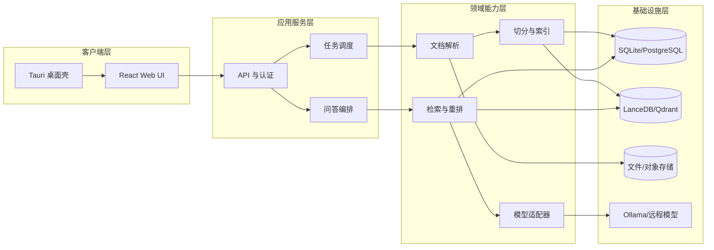

# 系统架构设计

## 1. 架构目标

系统需要同时满足个人单机、混合推理和企业私有部署，并尽可能复用前端、业务接口、领域模型与检索链路。跨平台意味着共享同一套源代码和协议，而不是发布一个同时适用于所有操作系统的安装文件。

Windows 与 macOS 共用一套源码是本项目的硬性架构约束。任何要求复制 UI、领域逻辑、RAG 流程或 API 实现才能支持另一平台的技术方案，均不进入选型范围。允许存在的平台差异必须封装为可替换的薄适配器，并由统一接口隔离。

## 2. 逻辑分层



## 3. 运行时组件

### 3.1 Desktop Shell

职责：

- 生命周期管理和单实例控制
- 启动、探测和停止本地 API 子进程
- 原生文件选择、通知和系统菜单
- 管理应用数据路径与升级
- 使用一次性凭证建立本地连接

桌面壳不负责文档解析、数据库查询和模型编排。

### 3.2 Web UI

职责：

- 知识库、文档、任务和模型管理
- 聊天、流式输出和引用展示
- 系统设置、诊断和备份入口
- 通过共享类型定义访问 API

### 3.3 Knowledge API

职责：

- 业务接口、输入验证和错误规范
- 本地会话与企业认证适配
- 文档、知识库与模型配置管理
- 检索和问答编排
- 事件流、任务进度与取消

### 3.4 Worker

MVP 可与 API 同进程运行，但接口必须按可拆分方式设计。企业版可将解析、OCR、Embedding 和索引任务拆为独立 Worker，并使用持久化队列调度。

## 4. 部署拓扑

### 4.1 本地模式

```text
Tauri Desktop
├─ React UI
├─ Knowledge API sidecar
├─ SQLite + FTS5
├─ LanceDB/sqlite-vec
├─ 本地文档目录
└─ Ollama/llama.cpp（可选）
```

所有服务只监听环回地址。API 端口由操作系统动态分配，启动时通过受控 IPC 返回给桌面壳。

### 4.2 企业模式

```text
Desktop / Browser
       │ HTTPS
       ▼
API Gateway / SSO
       │
Knowledge API ─ Worker Pool ─ Model Gateway
       │              │
PostgreSQL       Qdrant/Object Storage
```

企业模式必须在检索前应用权限过滤，而不是在回答生成后隐藏结果。

## 5. 模块边界

建议定义以下稳定接口：

- `DocumentParser`：文件到标准化文档结构
- `Chunker`：标准化文档到文本块
- `EmbeddingProvider`：文本到固定维度向量
- `VectorStore`：向量写入、过滤、查询与删除
- `KeywordIndex`：全文索引与查询
- `Reranker`：问题和候选块到排序分数
- `LLMProvider`：消息与上下文到流式回答
- `ObjectStore`：原文、预览和派生文件存储
- `IdentityProvider`：本地身份或企业身份认证

平台能力统一通过 `PlatformAdapter` 暴露，例如应用数据目录、文件选择、系统密钥链、通知、进程管理和自动更新。上层业务不得直接判断 `Windows` 或 `macOS`；确需平台条件编译时，只能出现在适配器或构建配置中。

## 6. 关键技术决策

### 6.1 Tauri 而不是 WPF

WPF 仅支持 Windows，Swift/AppKit 仅面向 macOS，分别开发会产生两套 UI 和维护成本，因此不作为产品主框架。Tauri 使用平台系统 WebView，能够让 Windows 和 macOS 共享 React UI 与业务协议，同时保持较小的安装体积。

### 6.2 Python 作为知识处理层

Python 在 PDF、Office、OCR、Embedding、Reranker 和模型生态上具有成熟工具。通过 sidecar 方式封装后，桌面层不依赖用户自行安装 Python。

### 6.3 本地存储可迁移

数据库不以用户绝对路径作为资源主键。文档使用 UUID、内容哈希、相对对象路径和版本号，使知识库能够备份并迁移到另一平台。

### 6.4 模型适配器

模型调用不散落在业务代码中。每个 Provider 声明能力，例如流式输出、工具调用、上下文长度、结构化输出和多模态，编排器根据能力选择策略。

## 7. 故障与恢复

- 每个导入任务持久化当前阶段、输入版本和错误信息。
- 写入新索引版本成功后再切换文档的活动版本。
- API 重启后将 `running` 且无租约的任务恢复为 `pending` 或 `failed`。
- Embedding 批次支持幂等键，避免重试产生重复向量。
- 删除操作先标记不可检索，再异步清理派生资源。

## 8. 可观测性

- 结构化日志禁止记录密码、完整 token 和不必要的原文内容。
- 为导入、检索、重排和模型调用生成关联 ID。
- 记录耗时、候选数量、分数分布和模型使用量。
- 本地版提供可导出的脱敏诊断包；企业版接入统一日志和指标平台。

## 9. 架构决策记录

重要决策应放入 `docs/adr/`，至少包括背景、选项、决定、影响和回退方案。适合记录的主题包括向量库选择、模型分发方式、OCR 引擎、企业多租户隔离和 macOS Universal Binary 支持策略。
