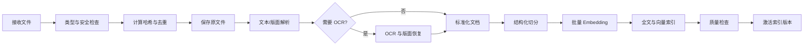
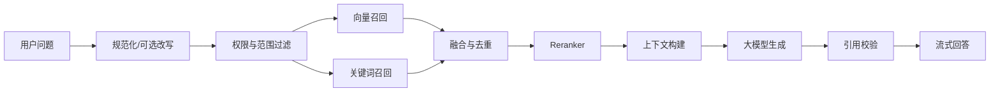

# RAG 与文档处理流程

## 1. 设计目标

RAG 流程的目标不是获得最多文本，而是检索出与问题最相关、权限允许、位置可追溯且适合模型理解的证据。解析、切分、检索和引用必须共享稳定的位置标识。

## 2. 导入流程



## 3. 标准化文档模型

解析器输出统一结构，而不是直接输出一串文本：

```json
{
  "document_id": "uuid",
  "title": "产品安装手册",
  "language": "zh-CN",
  "elements": [
    {
      "type": "heading",
      "level": 1,
      "text": "安装要求",
      "page": 3,
      "bbox": [72, 80, 510, 112]
    },
    {
      "type": "paragraph",
      "text": "安装前请确认……",
      "page": 3,
      "bbox": [72, 130, 510, 220]
    }
  ]
}
```

`bbox` 在格式支持时保留，用于 PDF 高亮和原文定位。无法提供页码的格式应使用标题路径、段落序号或单元格范围。

## 4. 解析策略

| 类型 | 主要处理方式 | 位置引用 |
|---|---|---|
| PDF | 文本层、版面块、表格，必要时 OCR | 页码与坐标 |
| DOCX | 标题、段落、列表、表格 | 标题路径与段落序号 |
| XLS/XLSX | 工作表、表格区域、公式展示值 | 工作表与单元格范围 |
| PPTX | 幻灯片文本、备注和表格 | 幻灯片编号 |
| Markdown | 标题树、段落和代码块 | 标题路径与行号 |
| TXT | 编码检测与段落识别 | 行号 |
| HTML | 正文提取、标题与列表 | DOM 路径或章节 |
| 图片 | OCR、版面区域和置信度 | 图片坐标 |

### 4.1 当前已实现的本地解析边界

- PDF 优先读取文本层；仅对文本不足的页面按需渲染并调用 RapidOCR，OCR 模型与页面内容均留在本机。
- DOCX 按正文顺序读取标题、段落与表格；表格转换为带表头的结构块，不与相邻正文混切。
- XLS/XLSX 按工作表读取展示值，以工作表名称作为章节，并在长表中重复表头分块；旧版 `.xls` 直接在本地解析，不依赖 Office 或 LibreOffice。
- v2 分块先把相邻段落、PDF 文本框和相邻页面聚合为不超过 3600 字的父上下文，再生成约 900 字的检索子块；子块仍保留页码、幻灯片或工作表定位。
- 连续对话先判断问题完整性，再分为独立问题、明确追问和不确定三类。完整短问题独立检索；明确追问改写为单一独立问题；不确定问题用本地 Embedding 比较主题并在必要时执行当前问题/改写问题双路召回。改写失败只使用当前问题，禁止机械拼接上一题。
- 单事实快速回答只处理单一问题槽位；包含多个问号或分号的多项问题必须进入逐项综合，避免第一个命中规则截断后续诉求。带离职、交接、资产归还等条件的工资问题不得使用普通发薪日快速答案。
- 本机 Ollama Embedding 使用有界进程内缓存复用完全相同的查询向量；年假语境下仅为“修完/休完”这类明确输入法混淆增加并行纠错查询，不全局改写用户原文。
- Ollama 对话使用原生 NDJSON 流，并设置 15 分钟模型驻留；输出长度随问题复杂度动态调整。
- PPTX 按幻灯片读取标题、文本框和表格，页码字段表示幻灯片编号，并保存 `kind=slide` 位置。
- HTML 删除 `script`、`style`、`noscript` 和 `template` 后，按标题、段落、列表和表格解析；不会执行脚本或访问外部 URL。
- 带文本层的 PDF 按 PyMuPDF 文本块保存页码、边界框和页面尺寸；扫描页 OCR 保存整页坐标。来源抽屉可调用本地预览接口渲染灰色半透明高亮 PNG，原文件不会被修改。
- 每个块保存 `content_kind=text|table|ocr`，检索结果能够区分普通文本、表格和 OCR 证据。
- OCR、Office 与 Excel 依赖均通过同一 Python Sidecar 打包，Windows 与 macOS 不维护两套解析代码。

## 5. 切分策略

### 5.1 基本原则

- 优先按标题、段落、列表、表格和语义边界切分。
- 不跨越明显章节边界拼接无关内容。
- 为每个块附加标题路径和必要的短上下文。
- 表格尽量保持表头与数据行关系。
- 代码块、公式和步骤列表避免在内部截断。
- 当前实现使用字符数进行确定性切分；后续模型化切分器再迁移为 token 预算。

### 5.2 初始参数

当前实现参数仍需通过更大规模真实语料调整：

- 检索子块：约 900 字符
- 相邻重叠：约 120 字符
- 上下文父块：最大约 3600 字符
- 单次回答候选召回：向量与关键词各 20–30 个
- 重排后上下文：通常 5–10 个块

### 5.3 父子块

父子块已接入主流程：子块负责 Embedding、FTS5、融合与重排，命中后将对应父块交给回答模型和来源抽屉。多个子块如果属于同一 `parent_chunk_id`，会在重排完成后去重。检索响应中的 `content` 始终是精确命中子块，`parent_content` 只作为上下文，不能覆盖或抬高检索分、重排分和证据分。

## 6. Embedding 与索引

- 向量记录必须保存 `embedding_model_id`、维度和模型版本。
- 不同维度或不兼容模型不能写入同一索引空间。
- 文本归一化规则和切分版本变化时，创建新的索引版本。
- 批量生成向量时使用内容哈希缓存相同文本结果。
- 激活新版本后再清理旧版本，保证查询不中断。

### 6.1 当前首版实现

- `EmbeddingProvider` 已提供 `OllamaEmbeddingProvider` 与 `HashingEmbeddingProvider` 两个实现。
- 生产 Sidecar 使用 `auto` 模式检测本机 Ollama `bge-m3`，不可用时回退到 `hashing-vector-v1`；测试默认固定使用 hashing，避免访问外部进程。
- Ollama 适配器使用 `/api/embed` 批量生成向量，服务地址只允许 HTTP 回环地址。
- SQLite `chunks` 保存模型 ID、维度和索引版本，`chunks_fts` 保存全文索引；查询时只比较模型 ID和维度兼容的向量。
- FTS5 优先使用 `trigram` tokenizer，不支持时回退 `unicode61`，保证 Windows 与 macOS 使用同一套业务源码。
- 已接入独立 `Reranker` 协议与 `local-feature-reranker-v1`。它是无额外模型依赖的确定性重排基线，不是 Cross-Encoder；模型重排器仍是后续增强项。
- 召回结果分别保存 `retrieval_score`、`rerank_score` 与 `evidence_score`。重排分只决定候选顺序，证据分专门用于拒答校准。
- 精确错误码和带单位数字作为硬锚点处理。语义相似但代码或金额不一致时，无论使用 hashing 还是真实 Embedding 都必须降权。
- `npm run api:eval:gate` 已作为 Windows/macOS CI 必过步骤；当前门槛为 Recall@5、MRR、片段 MRR ≥ 0.95，可回答性准确率 = 1.0。

## 7. 查询流程



### 7.1 混合检索

向量检索擅长语义近似，关键词检索擅长产品编号、专有名词、错误码和精确短语。两者使用 Reciprocal Rank Fusion 或可配置加权进行融合。

当前实现采用 RRF：分别取得兼容向量结果与 FTS5 结果，再按排名融合、应用精确锚点约束并交给独立 Reranker。返回结果保留 `vector_score`、`lexical_score`、`support_factor`、`retrieval_score`、`rerank_score`、`evidence_score`、`retrieval_mode`、`embedding_model_id` 和 `reranker_model_id`，便于诊断错误召回。

### 7.2 重排

Reranker 使用“问题 + 候选片段”计算相关性。重排前应用租户、知识库、权限、标签和时间过滤，重排后再进行相似内容去重与上下文预算控制。

### 7.3 上下文构建

上下文中的每个片段分配稳定引用编号，至少包含：

- 引用编号
- 文档标题
- 章节路径
- 页码或其他位置
- 原文片段
- 文档、子块与父块 ID
- `content_kind` 与格式相关的 `location`

模型只能引用提供的编号。回答完成后，服务端校验引用编号是否真实存在。

## 8. 防止幻觉

系统提示词应明确：

- 只依据给定资料回答事实性问题。
- 资料不足时直接说明不足。
- 不编造文档、页码、条款或数字。
- 区分资料中的事实与模型给出的建议。
- 每个关键事实尽量附引用。

服务端还应依据最低检索分数、引用覆盖和规则进行拒答或降级，而不能只依赖提示词。

## 9. 评测

建立版本化评测集，至少包含：

- 可直接回答的问题
- 需要跨段落组合的问题
- 精确编号和数字问题
- 表格问题
- 同义表达问题
- 知识库不存在答案的问题
- 无权限文档相关问题

离线指标包括 Recall@K、MRR、nDCG、引用正确率、回答正确率与拒答准确率。每次修改切分、Embedding、融合权重、Reranker 或提示词后运行回归评测。

默认 v2 评测集位于 `services/knowledge-api/evaluation/retrieval_realistic_v2.json`，运行：

```bash
npm run api:eval
```

真实 Ollama BGE-M3 评测：

```bash
npm run api:eval:bge
```

`zhiyu-retrieval-v2` 当前包含 8 份多章节合成文档、19 个可回答问题和 3 个无答案/难负样本。它同时计算文档级与片段级 Recall@K、MRR、nDCG 和 Answerability Accuracy。当前 hashing + 特征重排与 BGE-M3 + 特征重排的上述指标均为 `1.0`；关闭重排时 MRR 为 `0.9737`、nDCG@5 为 `0.9806`。

该基线的来源类型为 `synthetic`，不能作为真实企业效果结论。脱敏企业数据必须声明 `provenance.type=sanitized-enterprise`、匿名组织和复核日期，并使用：

```bash
npm run api:eval -- --dataset /absolute/path/to/sanitized-enterprise.json --require-real-corpus
```

没有用户提供且完成授权脱敏的语料时，只能报告合成工程门禁结果。详细规范见 `services/knowledge-api/evaluation/README.md`。
